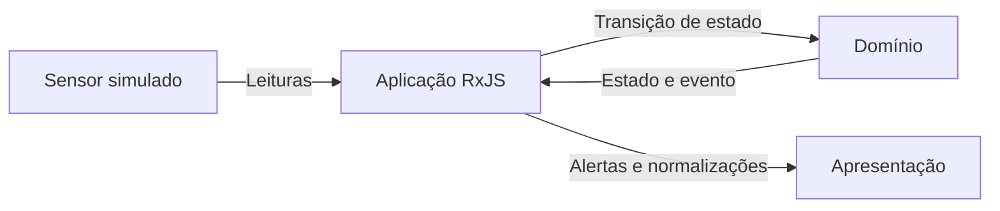

# Projeto de PLP com programação orientada a eventos.

Discentes

Daniel Mendes da Silva
Enrique Ferreira da Silva

# Harness para Agentes de IA — Monitoramento Reativo de Temperatura

Projeto acadêmico de backend que investiga a influência de um **harness de desenvolvimento** na implementação de software por agentes de IA, com foco em programação reativa e orientação a eventos.

## Objetivo

Comparar duas implementações da mesma funcionalidade, com e sem harness, considerando erros finais, violações arquiteturais e intervenções humanas corretivas.

## Aplicação

O sistema recebe 11 leituras simuladas de temperatura e processa os eventos utilizando TypeScript e RxJS (`Observable`, `scan`, `filter` e `map`).

- Três leituras consecutivas de 30 °C ou mais emitem um alerta crítico.
- Alertas não são repetidos enquanto o estado crítico permanece ativo.
- Uma leitura abaixo de 28 °C normaliza o estado e permite novos alertas.
- Leituras intermediárias ou não finitas interrompem a contagem pendente.

A demonstração utiliza aleatoriedade controlada e produz a sequência `critical → normalized → critical`. Os testes utilizam entradas controladas para garantir a reprodutibilidade.

## Harness

| Componente | Finalidade |
|---|---|
| `AGENTS.md` | Orientações de desenvolvimento para o agente |
| `ARCHITECTURE.md` | Separação de responsabilidades e regras entre camadas |
| TypeScript strict | Verificação de tipagem |
| ESLint | Análise estática do código |
| dependency-cruiser | Validação de dependências arquiteturais |
| Vitest | Testes automatizados |
| `npm run validate` | Integração das verificações |
| GitHub Actions | Automação da validação |

## Arquitetura



## Experimento

Foram realizadas duas sessões separadas no Google Antigravity, com Claude Sonnet 4.6 como modelo declarado e os mesmos requisitos funcionais.

- **Baseline:** estrutura inicial e prompt comum, sem o harness do projeto.
- **With-harness:** mesma estrutura e prompt, com instruções, regras e ferramentas de validação adicionais.

Após a implementação, ambas as versões foram submetidas à mesma avaliação independente, composta por 8 testes de monitoramento, 5 testes do simulador e verificações de tipagem, lint e arquitetura.

## Resultados — Trial 01

| Métrica | Sem harness | Com harness |
|---|---:|---:|
| Testes independentes aprovados | 13/13 | 13/13 |
| Testes reprovados | 0 | 0 |
| Erros finais de TypeScript | 0 | 0 |
| Erros finais de ESLint | 0 | 0 |
| Violações arquiteturais detectadas | 0 | 0 |
| Intervenções humanas registradas | 0 | 0 |

**Análise qualitativa:** a versão sem harness concentrou as regras de negócio e o fluxo RxJS em `application/monitor.ts`. A versão com harness separou a política de domínio em `domain/temperature-policy.ts` e a formatação em `presentation/formatter.ts`, alinhando-se mais explicitamente à arquitetura proposta.

**Conclusão:** não houve diferença quantitativa nas métricas finais. Observou-se uma separação de responsabilidades mais explícita na versão com harness. A auditoria automática não cobre todas as regras semânticas da arquitetura; os registros das sessões são resumos e houve apenas uma execução por condição. Assim, os resultados são exploratórios e não demonstram superioridade geral do harness. Os zeros representam erros finais e intervenções declaradas, não ausência de erros durante o desenvolvimento.

Consulte o [relatório comparativo](evaluation/results/trial-01-comparison.md) e os códigos avaliados em `evaluation/results/`.

## Como executar

**Pré-requisitos:** Node.js 22.16+ (recomenda-se a versão 22) e npm. Na raiz do projeto:

```bash
npm install
npm run demo
npm run validate
```

A demonstração da raiz utiliza a implementação de referência, separada dos códigos experimentais.

Para repetir o experimento, crie um novo identificador:

```bash
npm run experiment:prepare -- --trial trial-02
```

Instale as dependências em cada workspace criado, execute duas sessões independentes do mesmo agente e registre as sessões e intervenções conforme o [protocolo experimental](evaluation/methodology.md). Após a geração, volte à raiz e execute:

```bash
npm run experiment:evaluate -- --trial trial-02
npm run experiment:compare -- --trial trial-02
```

## Estrutura do repositório

```text
src/                         Implementação de referência
experiment/seed/             Estrutura inicial comum
experiment/harness-overlay/  Instruções e ferramentas do harness
runs/                        Ambientes experimentais
tests/                      Testes de apoio e verificações offline
evaluation/                 Testes externos, metodologia e resultados
scripts/                    Preparação, validação e comparação
docs/                       Documentação complementar
```

Projeto desenvolvido para fins acadêmicos. Consulte a documentação e as evidências experimentais para reprodução dos resultados.
